<p align="center">
  <picture>
    <source media="(prefers-color-scheme: dark)" srcset="assets/logo/logo-orizzontale-scuro.png">
    
  </picture>
</p>

# Compendio Incantesimi Homebrew

[](https://gdr-sys.github.io/Compendio-incantesimi-homebrew/)
[](https://github.com/gdr-sys/Compendio-incantesimi-homebrew/commits/main)
[](https://github.com/gdr-sys/Compendio-incantesimi-homebrew)
[](https://github.com/gdr-sys/Compendio-incantesimi-homebrew/issues)
[](https://developer.mozilla.org/it/docs/Web/HTML)
[](https://developer.mozilla.org/it/docs/Web/CSS)
[](https://developer.mozilla.org/it/docs/Web/JavaScript)

**Compendio Incantesimi Homebrew** è un'applicazione web "all-in-one" pensata per Dungeon Master e giocatori di D&D che vogliono un unico posto dove organizzare incantesimi ufficiali (SRD 2014 e 2024) e creazioni originali (Homebrew), trasformarli in vere carte da stampare e tenerli sotto mano durante la partita.

L'app è **pronta all'uso**: si apre nel browser, senza account e senza installare nulla. I dati restano sul tuo dispositivo.

**[Apri il Compendio](https://gdr-sys.github.io/Compendio-incantesimi-homebrew/)**

<p align="center">
  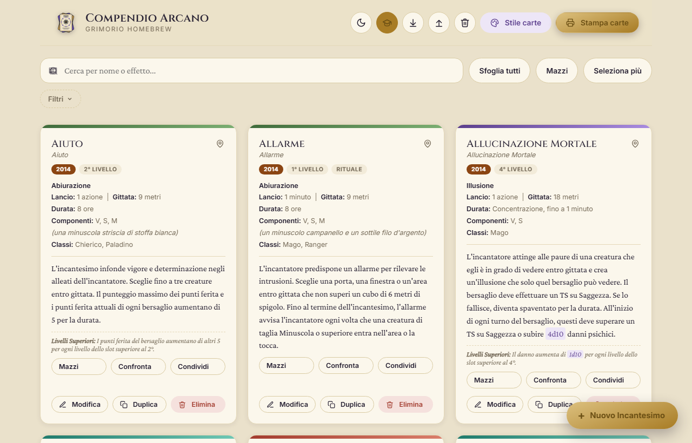
</p>

---

## Indice

- [Funzionalità](#funzionalità)
- [Gestione degli incantesimi](#gestione-degli-incantesimi)
- [Ricerca e filtri](#ricerca-e-filtri)
- [Mazzi per personaggio](#mazzi-per-personaggio)
- [Modalità sessione](#modalità-sessione)
- [Dadi con un clic](#dadi-con-un-clic)
- [Confronto tra edizioni](#confronto-tra-edizioni)
- [Stampa delle carte](#stampa-delle-carte)
- [Condividere mazzi e incantesimi](#condividere-mazzi-e-incantesimi)
- [Uso offline e installazione](#uso-offline-e-installazione)
- [Come iniziare](#come-iniziare)
- [Note su localStorage e portabilità dei dati](#note-su-localstorage-e-portabilità-dei-dati)
- [Tecnologie utilizzate](#tecnologie-utilizzate)
- [Struttura del progetto](#struttura-del-progetto)
- [Contribuire](#contribuire)

## Funzionalità

- **Database SRD integrato**: 508 schede ufficiali (110 dell'edizione 2014 e 398 della 2024) già pronte all'uso, ricercabili per nome, con etichetta di edizione sempre visibile.
- **Editor completo per incantesimi Homebrew**: campi dedicati per nome ITA/ENG, scuola, livello, tempo di lancio, gittata, durata, componenti (Verbale, Somatico, Materiale con descrizione dei materiali), rituale, concentrazione, classi, effetto e livelli superiori, oltre a un campo opzionale per tipo e quantità di danno/cura.
- **Mazzi per personaggio**: liste con nome da aprire, stampare e condividere con un clic.
- **Modalità sessione**: slot da spuntare, promemoria della concentrazione e riposo lungo, separati per ogni mazzo.
- **Dadi con un clic**: ogni formula nel testo, come 8d6, si può tirare direttamente.
- **Confronto 2014/2024**: le due versioni ufficiali affiancate, con le differenze evidenziate.
- **Ricerca estesa**: la barra di ricerca principale cerca sia nel nome sia nel testo dell'effetto e dei livelli superiori.
- **Filtri combinabili**: per edizione, livello, classe, scuola, tempo di lancio, concentrazione e rituale.
- **Carte da stampare**: formato poker o grande, testo sempre leggibile, fronte-retro allineato e linee di taglio.
- **Tabelle vere nel testo**: a schermo e sulle carte, anche negli incantesimi Homebrew.
- **Sfoglia tutti gli incantesimi SRD**: elenco completo consultabile con gli stessi filtri della lista principale, con un pulsante per aggiungere in blocco tutti i risultati filtrati al grimorio in un solo clic.
- **Duplica incantesimo**: crea rapidamente una variante di un incantesimo esistente senza reinserire tutti i campi.
- **Azioni in blocco**: modalità di selezione multipla per eliminare, duplicare, assegnare una classe o aggiungere a un mazzo più incantesimi contemporaneamente.
- **Incantesimi memorizzati**: contrassegna gli incantesimi usati più spesso per ritrovarli rapidamente in cima alla pagina.
- **Modalità chiara e scura**: interfaccia adattiva per non affaticare la vista durante le sessioni serali.
- **Supporto immagini**: carica un'illustrazione personalizzata per fronte e retro di ogni carta.
- **Gestione classi personalizzate**: aggiungi nuove classi (es. Artefice) direttamente dal form, disponibili subito anche nei filtri.
- **Condivisione e backup**: passa un mazzo con un link o un file, oppure esporta l'intero grimorio in un file `.json`.
- **Uso offline**: dopo la prima visita il sito si apre anche senza connessione.
- **Interfaccia responsive**: layout ottimizzato sia per desktop sia per l'uso da smartphone.

<p align="center">
  
  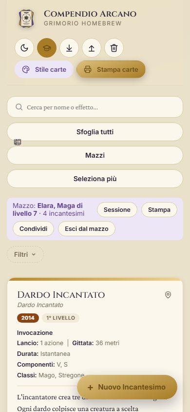
</p>

## Gestione degli incantesimi

Ogni incantesimo, sia esso importato dal database SRD sia creato da zero, può essere modificato liberamente in qualunque momento. Le informazioni SRD non vengono mai sovrascritte automaticamente: se un incantesimo esiste nel database solo per una determinata edizione, viene mostrato e catalogato esclusivamente con quel tag, senza sostituzioni implicite tra versioni diverse.

Sulla scheda di ogni incantesimo trovi, oltre a modifica, duplicazione ed eliminazione, i pulsanti **Mazzi**, **Condividi** e, quando esistono entrambe le edizioni, **Confronta**.

### Tabelle nel testo

Nel campo dell'effetto si possono scrivere tabelle: basta iniziare e finire ogni riga con una barra verticale e separare le colonne allo stesso modo. Servono almeno due righe consecutive e la prima diventa l'intestazione.

```text
| Tiro  | Risultato      |
| 1-3   | Nessun effetto |
| 4-6   | Danni dimezzati |
```

Le tabelle compaiono anche sulle carte e restano sempre intere: se il testo prosegue su più carte, la divisione avviene prima o dopo la tabella.

<p align="center">
  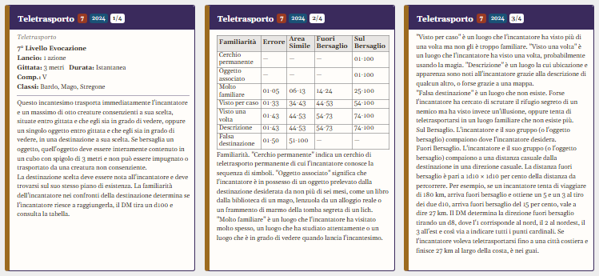
</p>

## Ricerca e filtri

La ricerca e i filtri lavorano insieme e valgono ovunque: nella lista principale, nella finestra "Sfoglia tutti" e nella finestra di stampa. I filtri attivi restano visibili e si possono togliere uno alla volta o tutti insieme.

| Filtro | Valori |
|---|---|
| **Edizione** | Homebrew, 2014, 2024 |
| **Livello** | Dal trucchetto al 9° |
| **Classe** | Le classi disponibili e quelle che aggiungi tu |
| **Scuola** | Le otto scuole di magia |
| **Tempo di lancio** | Azione, azione bonus, reazione, minuti o più |
| **Proprietà** | Concentrazione, senza concentrazione, rituale |

Dentro lo stesso gruppo basta che sia vera una delle scelte; gruppi diversi si sommano. Per esempio "Reazione" più "Abiurazione" mostra solo le reazioni di quella scuola.

<p align="center">
  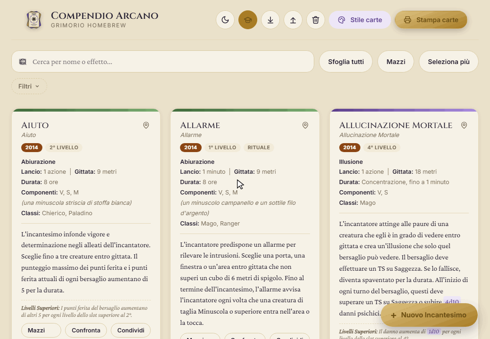
</p>

## Mazzi per personaggio

Un mazzo è una lista di incantesimi con un nome, per esempio uno per ogni personaggio. Gli incantesimi non vengono copiati: uno stesso incantesimo può stare in più mazzi e, se lo modifichi, la modifica vale ovunque.

1. Premi **Mazzi** accanto alla barra di ricerca e crea un mazzo, oppure crealo direttamente dalla scheda di un incantesimo.
2. Premi **Mazzi** sulla scheda e spunta le liste in cui vuoi l'incantesimo. Con "Seleziona più" puoi farlo per molti incantesimi insieme.
3. Premi **Apri**: la lista mostra solo quel mazzo e una barra in alto dà accesso a sessione, stampa e condivisione. "Esci dal mazzo" riporta all'intero grimorio.

Il pulsante **Stampa** apre la finestra di stampa con tutto il mazzo già selezionato.

<p align="center">
  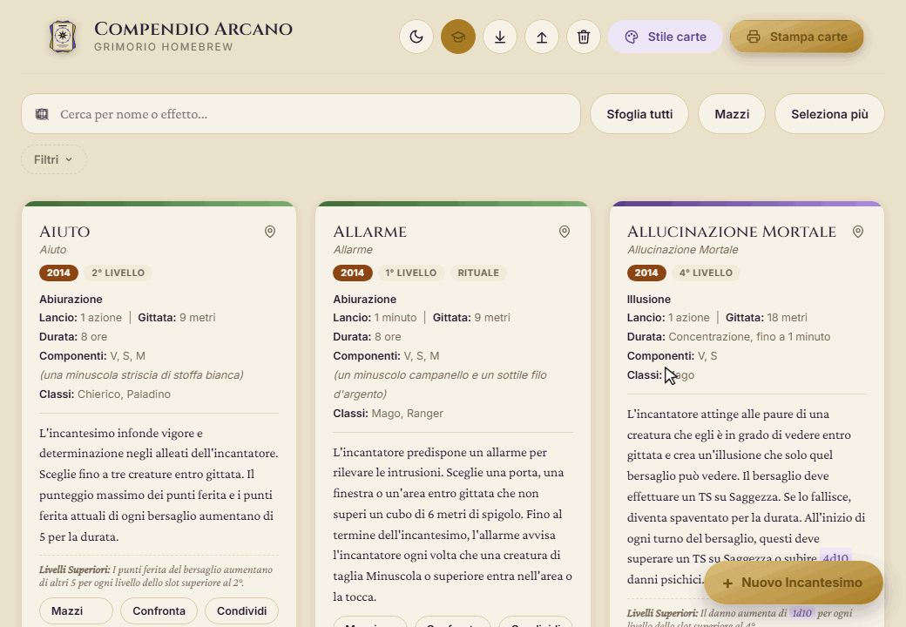
</p>

<p align="center">
  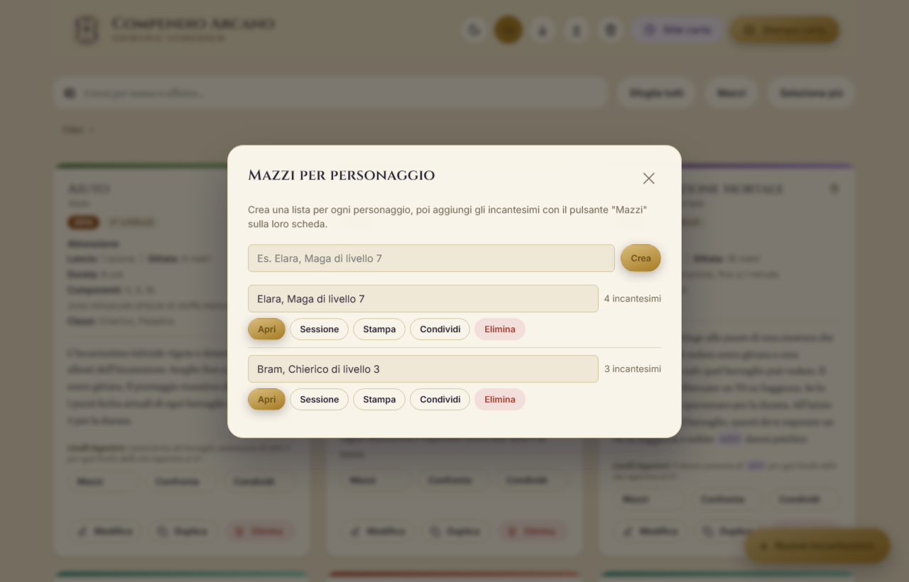
</p>

## Modalità sessione

La sessione tiene il conto di ciò che succede al tavolo, separatamente per ogni mazzo. Lo stato resta salvato anche chiudendo la pagina.

- **Slot incantesimo**: con `+` e `−` imposti quanti slot ha il personaggio per ogni livello. Toccando un pallino lo segni come usato o di nuovo disponibile.
- **Lancia**: scegli lo slot, anche di livello superiore, e l'app lo consuma.
- **Rituale**: gli incantesimi rituali hanno un pulsante che non consuma slot.
- **Concentrazione**: lanciando un incantesimo con concentrazione, l'app lo mette in evidenza. Se ne lanci un altro, ti avvisa che il precedente termina.
- **Riposo lungo**: dopo una conferma, riporta disponibili tutti gli slot e termina la concentrazione.
- **Testo a portata di mano**: toccando il nome di un incantesimo se ne legge la descrizione, con i dadi già pronti da tirare.

Il riposo breve non è gestito in automatico: per gli slot del Warlock basta toccare i pallini usati.

<p align="center">
  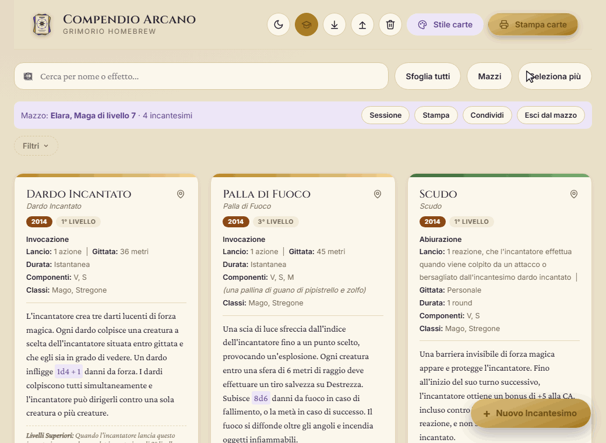
</p>

<p align="center">
  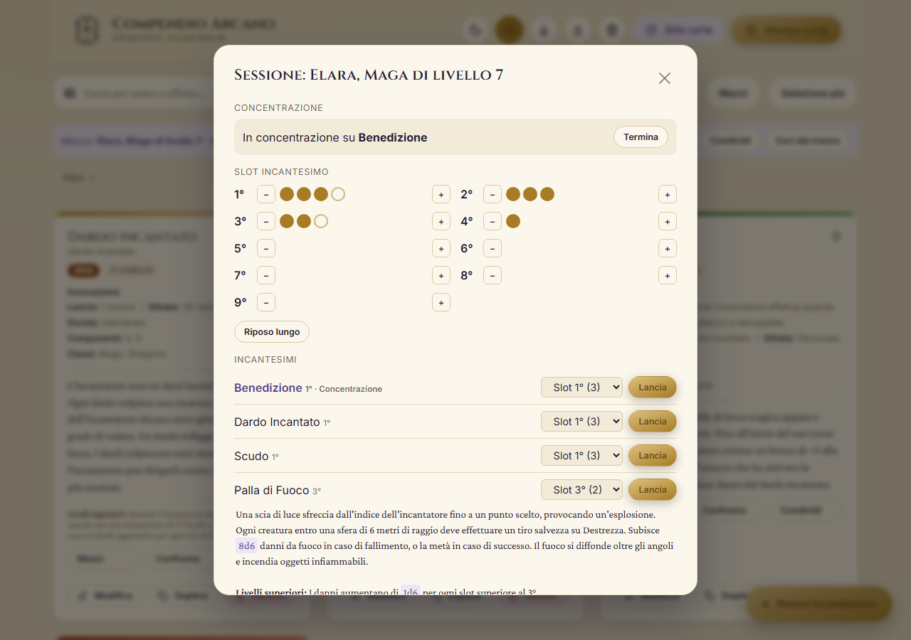
</p>

## Dadi con un clic

Le formule nel testo degli incantesimi, come `8d6`, `d20 + 3` o `1d10`, sono evidenziate. Toccandone una esce il tiro, con il totale e il dettaglio di ogni dado. Funziona sulle schede e nella modalità sessione; sulle carte stampate il testo resta normale.

<p align="center">
  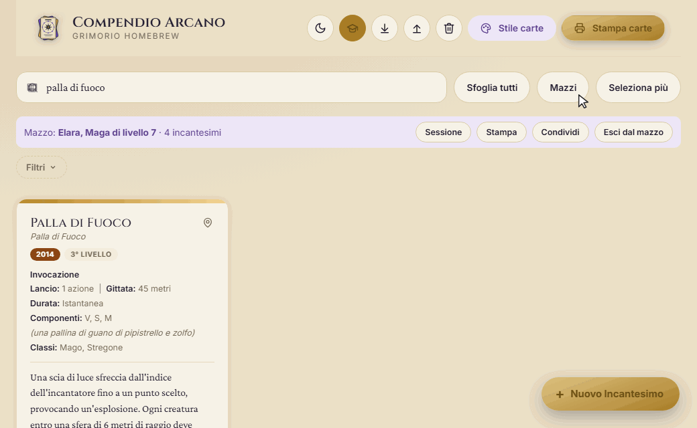
</p>

## Confronto tra edizioni

Quando un incantesimo esiste sia nella versione 2014 sia nella 2024, il pulsante **Confronta** le mette affiancate. Le caratteristiche che cambiano sono evidenziate e, nel testo dell'effetto e dei livelli superiori, le parole diverse sono colorate. Il confronto usa sempre i testi ufficiali SRD, anche se hai modificato la tua copia.

<p align="center">
  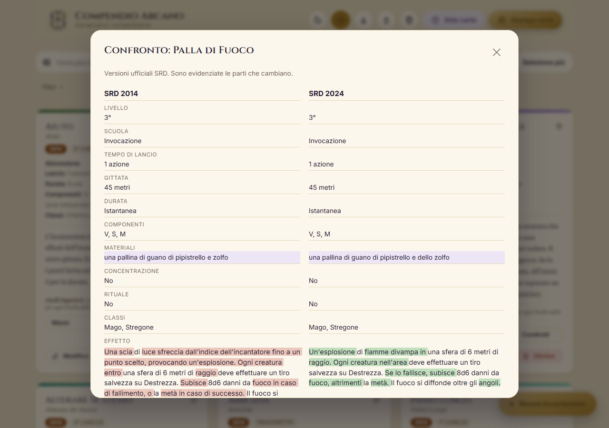
</p>

## Stampa delle carte

Il compendio genera fogli A4 pronti per la stampa, con le misure delle carte espresse in millimetri.

| Formato | Misura | Carte per foglio |
|---|---|---|
| **Poker** | 63 x 88 mm | 9 |
| **Grande** | 95 x 133 mm | 4 |

<p align="center">
  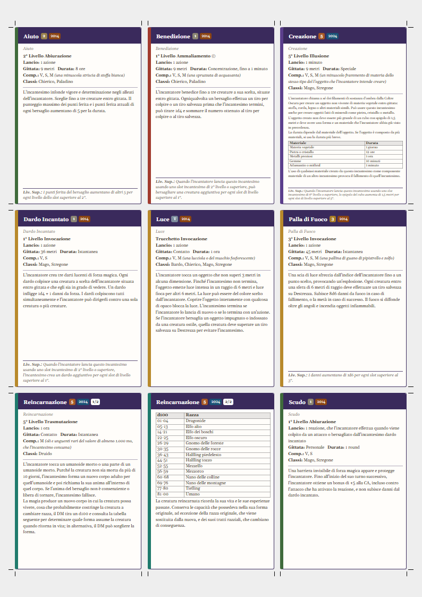
</p>

- **Fronte carta**: nome, scuola, tempo di lancio, gittata, durata, componenti, classi ed effetto, con colore di intestazione diverso per scuola di magia.
- **Formato per singola carta**: il formato generale vale per tutto il mazzo, ma ogni incantesimo può usarne uno diverso; ogni formato viene stampato su fogli propri.
- **Testo sul fronte**: uno slider regola la dimensione (60%-130%) e l'adattamento automatico riduce il testo solo sulle carte in cui non entrerebbe.
- **Testo troppo lungo**: la misura della carta non cambia mai. Puoi scegliere se dividere il testo su più carte, numerate 1/2 e 2/2, oppure tenere una carta sola con le scritte minuscole. Con la divisione il testo non scende sotto circa 4,5 pt.
- **Carte divise**: si stampano solo fronte, come carte separate, oppure fronte-retro, con il seguito del testo sul retro.
- **Una sola edizione**: se hai scelto lo stesso incantesimo in 2014 e 2024, puoi stampare soltanto la versione che preferisci. Il conteggio indica quanti doppioni vengono esclusi.
- **Linee di taglio**: piccoli segni attorno alle carte per tagliarle più in fretta e più dritte. Compaiono solo sul lato del fronte.
- **Retro carta personalizzabile**: scegli quali informazioni mostrare sul retro tra livello, tipo di azione, raggio, concentrazione, durata, scuola, rituale, componenti, materiali, classi e danno/cura, oppure usa un retro decorativo uniforme per l'intero mazzo.
- **Anteprima reale**: in "Stile carte" vedi la carta con lo stesso testo e la stessa impaginazione che andranno in stampa.
- **Ordinamento**: per nome, livello o classe, con il conteggio degli incantesimi selezionati.
- **Filtri applicati anche in stampa**: la finestra di stampa mostra sempre solo gli incantesimi che corrispondono ai filtri, alla ricerca e al mazzo attivi in quel momento.
- **Font incluso**: le carte usano sempre il font Gelasio, così il testo occupa lo stesso spazio su ogni computer.

<p align="center">
  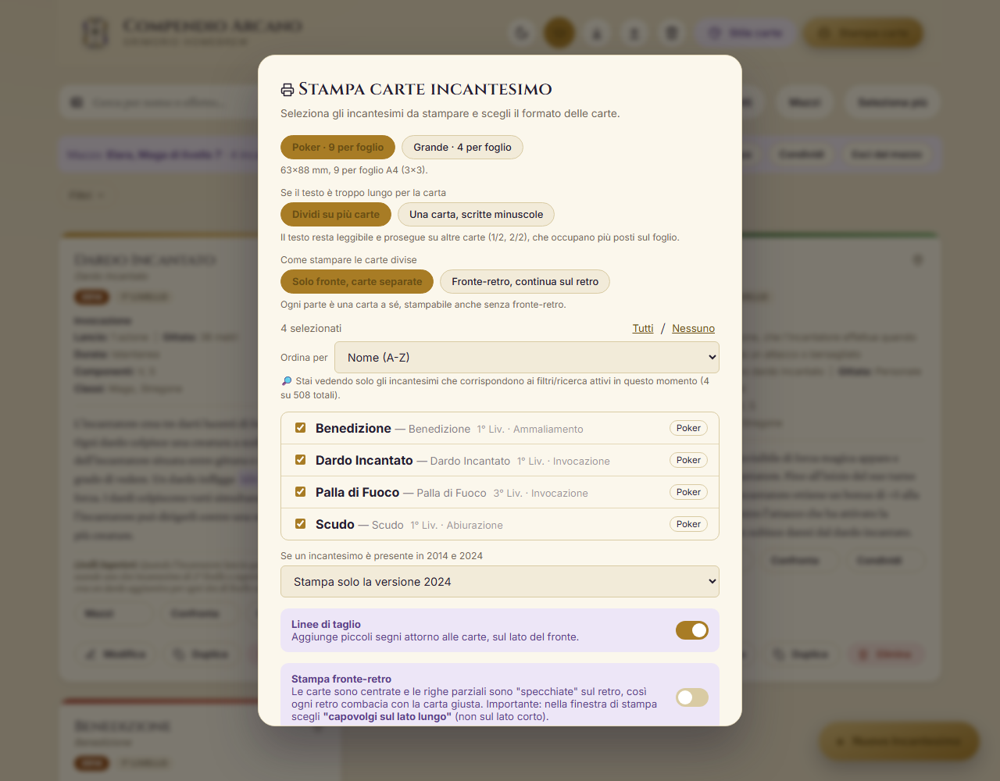
</p>

<p align="center">
  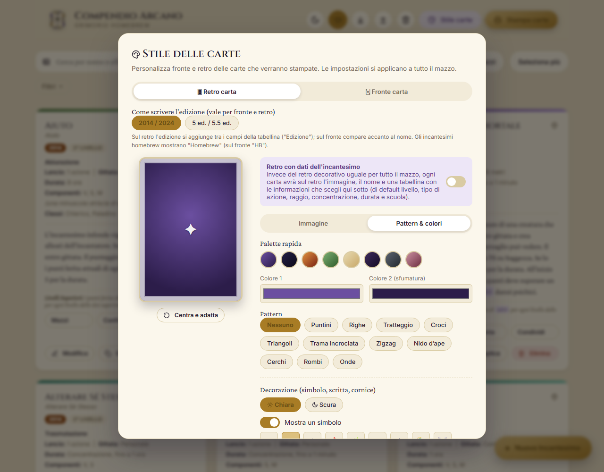
</p>

### Stampare fronte-retro

1. Attiva **Stampa fronte-retro** nella finestra di stampa.
2. Nella finestra del browser imposta il formato A4, la scala al 100% e la stampa degli sfondi.
3. Scegli **capovolgi sul lato lungo**, non sul lato corto.
4. Se il retro risulta spostato, misura lo scarto su una prova e correggilo nei campi "Scarto orizzontale" e "Scarto verticale": il valore resta salvato per le stampe successive.

Ogni foglio è composto da un fronte seguito dal proprio retro, con le righe specchiate: così anche le righe incomplete coincidono con la carta giusta.

## Condividere mazzi e incantesimi

Il pulsante **Condividi**, sui mazzi e sulle singole schede, offre due modi per passare il tuo lavoro ad altre persone.

- **Link**: contiene direttamente il mazzo, senza caricarlo su alcun server. Gli incantesimi SRD non modificati viaggiano come riferimento, quindi il link resta corto.
- **File**: da aprire con il pulsante Importa. È la scelta giusta per mazzi molto lunghi e l'unica che include le immagini.

Chi riceve un mazzo deve confermare l'importazione. Gli incantesimi vengono aggiunti al suo grimorio senza sostituire nulla e quelli già presenti non vengono duplicati.

<p align="center">
  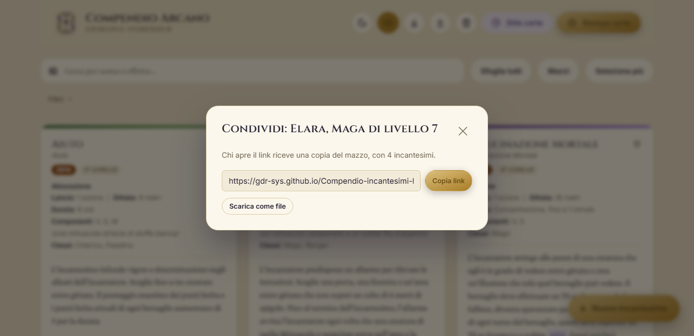
</p>

## Uso offline e installazione

Dopo la prima visita al sito con la connessione attiva, il Compendio si apre anche offline, comodo dove il segnale è scarso. Quando sei online vengono sempre caricati gli aggiornamenti più recenti.

Il font delle carte è incluso; senza connessione, i caratteri dell'interfaccia possono essere sostituiti da quelli del sistema. Le immagini che hai inserito tramite un indirizzo web richiedono la connessione.

Se il browser lo consente, dal suo menu puoi anche installare il Compendio come app. L'uso offline funziona dal sito, non aprendo `index.html` direttamente dal disco.

## Come iniziare

Non serve installare nulla.

1. Apri il sito: <https://gdr-sys.github.io/Compendio-incantesimi-homebrew/>
2. (Opzionale) Importa un file JSON esportato in precedenza per ripristinare i tuoi dati.
3. Cerca un incantesimo dal database SRD oppure creane uno nuovo con il pulsante dedicato.
4. Crea un mazzo per il tuo personaggio, stampa le carte o aprilo in modalità sessione.

In alternativa, puoi scaricare il repository e aprire `index.html` direttamente nel browser: in questo caso, se il browser blocca l'accesso al salvataggio locale sui file aperti direttamente dal disco, l'app te lo segnala con un avviso e continua a funzionare comunque, senza salvare le modifiche tra un caricamento e l'altro.

## Note su localStorage e portabilità dei dati

I dati vengono salvati nel `localStorage` del browser in uso: cambiare browser, dispositivo o svuotare la cache comporta la perdita dei dati se non sono stati esportati in precedenza. Si consiglia di usare regolarmente la funzione di esportazione per avere un backup del proprio grimorio.

| Cosa vuoi conservare | Come fare |
|---|---|
| **Incantesimi, con le loro immagini** | Pulsante Esporta in alto |
| **Un mazzo** | Condividi, poi "Scarica come file" |
| **Stile delle carte, classi personalizzate e stato della sessione** | Restano nel browser in uso e non sono inclusi nei file |

Importare un backup completo sostituisce il grimorio attuale, mentre importare un mazzo condiviso lo aggiunge. Se la memoria del browser si riempie, ad esempio per molte immagini grandi, l'app avvisa che l'ultima modifica non è stata salvata.

## Tecnologie utilizzate

- **HTML5 e CSS3**: layout responsivo, CSS Grid per la griglia di stampa e variabili CSS per il sistema di temi.
- **JavaScript nativo (Vanilla JS)**: gestione dello stato e manipolazione del DOM senza framework o librerie esterne.
- **Web Storage API**: persistenza dei dati tramite `localStorage`, con gestione automatica di fallback in memoria quando non disponibile.
- **FileReader API**: conversione delle immagini in stringhe Base64 per l'archiviazione nel JSON.
- **Compression Streams API**: compressione dei mazzi all'interno dei link di condivisione.
- **Service Worker e Web App Manifest**: uso offline e installazione come app.

## Struttura del progetto

L'applicazione è contenuta in un singolo file `index.html`, che include markup, fogli di stile, logica applicativa e database SRD, senza passaggi di build o dipendenze da installare.

```text
index.html             L'applicazione e il database SRD
sw.js                  Uso offline
manifest.webmanifest   Installazione come app
assets/fonts/          Font delle carte (Gelasio, licenza OFL)
assets/icons/          Icone dell'app
assets/logo/           Logo del progetto
data/                  Nuovi incantesimi proposti e relativo schema
scripts/               Unione automatica dei nuovi incantesimi
docs/media/            Immagini e animazioni di questo README
```

## Contribuire

Segnalazioni di problemi e proposte di miglioramento sono benvenute tramite la sezione [Issue](https://github.com/gdr-sys/Compendio-incantesimi-homebrew/issues) del repository. Per aggiungere nuovi incantesimi segui la guida in [CONTRIBUTING.md](CONTRIBUTING.md).
